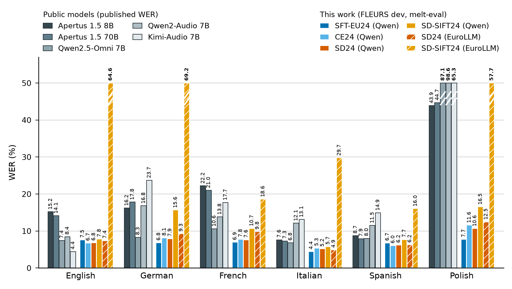

# charts: figures for the paper and the master results table

Every figure here is drawn from **one** table, `results_master.csv`: one row per model, one column per measurement,
named `<set>.<fmt>.<metric>.<unit>` (for example `fleurs24-asr-dev.repeatfirst.wer.en`, the WER of a model on the
English FLEURS dev clips under the repeat-first prompt). Several sessions read and write that table; the rules that
keep it one table are in **[PROTOCOL.md](PROTOCOL.md)**. Read them before you write to it.

## Figure 1: FLEURS WER, our checkpoints next to public audio LLMs



`fig_fleurs_asr_vs_baselines.py` puts the published FLEURS WER of Apertus 1.5 (8B, 70B), Qwen2.5-Omni, Qwen2-Audio
and Kimi-Audio (Table 35 of the Apertus 1.5 report, copied into `published/`) beside our checkpoints scored by
melt-eval on FLEURS dev, for the languages the published table covers that one of our models also handles: English,
German, French, Italian, Spanish and Polish. Colour is the recipe (blue SFT-EU24, light blue CE24, red SD24, orange
SD-SIFT24), hatching marks the EuroLLM decoder, greys are the public models. Bars above `--ymax` (50) are cut with a
break mark and keep their value, so the languages everyone handles stay readable next to Polish, where three public
models fail.

**Read it with these limits.** The two groups are not scored alike. Ours: a frozen subset of 100 clips per language
of the FLEURS dev split, the Whisper multilingual (`basic`) normaliser, the repeat-first prompt. Published: the
table does not say which FLEURS split or which normaliser it used, and the Apertus authors ran every model
themselves under one greedy decoding setup, so the numbers differ from each model's own paper. A gap of a few WER
points between the groups is inside the noise of a 100-clip subset. Ukrainian is in the published table but in none of
our models' languages (its CER on the selection metric's FLEURS set is 77-123 % for all of them), so it is left out;
the script says so when it runs. `SD-SIFT24 (EuroLLM)` is the EuroLLM variant whose decoder runs away on part of the
clips (see the self-distillation README): its bars are real, not a plotting error.

```bash
source /mnt/scratch-artemis/giuseppe/venvs/melteval/bin/activate     # any venv with numpy and matplotlib
python projects/ablation-campaign/charts/fig_fleurs_asr_vs_baselines.py                      # paper size, figures/*.pdf and *.png
python projects/ablation-campaign/charts/fig_fleurs_asr_vs_baselines.py --context poster     # large fonts, no per-bar numbers
python projects/ablation-campaign/charts/fig_fleurs_asr_vs_baselines.py --help
```

| option | does |
|---|---|
| `--context paper\|poster` | figure size, font sizes, per-bar numbers (paper: 7 x 3.2 in at 300 dpi, numbers on; poster: 14 x 6.6 in, off) |
| `--ours KEY ...`, `--baselines KEY ...` | which rows to draw (default: every active one with data, ordered by the master's `order`) |
| `--include-start` | also draw the start checkpoints A and A', which fail on every language they were not trained on |
| `--langs en de ...` | languages to show (default: the published table's, minus those none of ours has) |
| `--ymax N` | cut bars above N percent WER |
| `--ours-set`, `--ours-fmt` | which of our columns to use (default `fleurs24-asr-dev`, `repeatfirst`; `sft-random` gives the random-template numbers) |
| `--[no-]labels`, `--title`, `--stem`, `--out-dir`, `--formats` | per-bar numbers, title, file name, folder, `pdf`/`png`/`svg` |
| `--master PATH` | another copy of the master, for example one read with `git show` from the results branch |

It needs only the standard library, numpy and matplotlib, and reads nothing but the master. It prints the table it
drew and a caption with the caveats above. The PDF and PNG carry the master's SHA-256 (in `Subject`, and in the PNG
text), and the PDF has no creation date, so the same master and options give the same bytes.

## The master, and how to use it

```bash
C=projects/ablation-campaign/charts
python3 $C/master.py show                                              # the models
python3 $C/master.py show -m SD24 -c 'fleurs24-asr-dev.repeatfirst.wer.*'   # some cells
python3 $C/master.py columns 'selection-*'                             # columns and how many models fill each
python3 $C/master.py columns --sets                                    # the registered evaluation sets
python3 $C/master.py validate                                          # 0 problems, or a list
python3 $C/master.py export-long --out /tmp/long.csv                   # one row per measurement, for pandas or R
```

On 2026-10-16 it holds 13 models and 882 measurement columns:

| rows | from | cells |
|---|---|---|
| A, SFT-EU24, CE24, SD24, SD-SIFT24 (Qwen3.5-2B decoder), A', SD24 and SD-SIFT24 on EuroLLM-1.7B | `eu24_report.py` reports of the saved checkpoints | FLEURS-24 dev ASR (WER, CER per language), X->en and en->X ST (chrF++, spBLEU, BLEU, chrF, cased and lowercased, per language), under the repeat-first prompt and, for all but A, the random SFT templates; the selection metric (per-language CER on its 26-language FLEURS and five in-domain sets, runaway shares, group medians, score) under repeat-first |
| Apertus 1.5 8B and 70B, Qwen2.5-Omni 7B, Qwen2-Audio 7B, Kimi-Audio 7B | `published/apertus15-table35-fleurs-wer.csv` | published FLEURS WER for English, German, French, Italian, Spanish, Polish, Ukrainian |

The SFT-EU24 and CE24 runs on EuroLLM (MN5 jobs 47361362 and 47361363) are not scored yet; when they are, their rows
are one `ingest_eu24_report.py` call each (PROTOCOL.md §4). `PROTOCOL.md` §8 lists what else is not in yet.

## Files

| file | what |
|---|---|
| `PROTOCOL.md` | how sessions read and write the master |
| `results_master.csv`, `results_sets.csv`, `results_changelog.csv` | the table, the registry of its evaluation sets, the append-only log of every write |
| `master.py` | the only writer (lock, schema, no silent overwrite, changelog, cell-level merge driver) and the command line above |
| `ingest_eu24_report.py` | an `eu24_report.json` into the master |
| `ingest_published.py`, `published/` | hand-copied published tables into the master |
| `fig_fleurs_asr_vs_baselines.py`, `figures/` | figure 1 and its output |
| `test_master.py`, `test_fig_fleurs_asr_vs_baselines.py` | tests; `python -m pytest projects/ablation-campaign/charts -q` in the melteval venv (the figure tests skip without matplotlib) |

## Adding a figure

One script per figure, named `fig_<what>.py`, following figure 1:

- it reads **only** `results_master.csv` (labels, order, kinds and numbers all come from it) and nothing is typed
  into the script except presentation: colours, sizes, language names;
- everything else is an option, with the defaults that give the paper figure, and `--context paper|poster` switches
  the sizes;
- it uses the standard library, numpy and matplotlib only, so it can be copied to another repository;
- it writes into `figures/`, embeds the master's hash, prints the table it drew, and prints a caption that states
  how the compared numbers were obtained and where they are not comparable;
- a number it needs that is not in the master is added to the master first, through the protocol, never read from
  another file.
